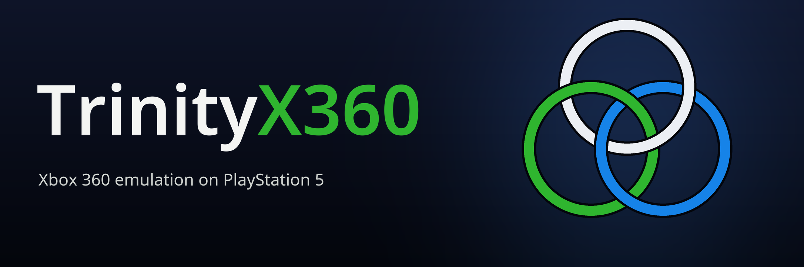
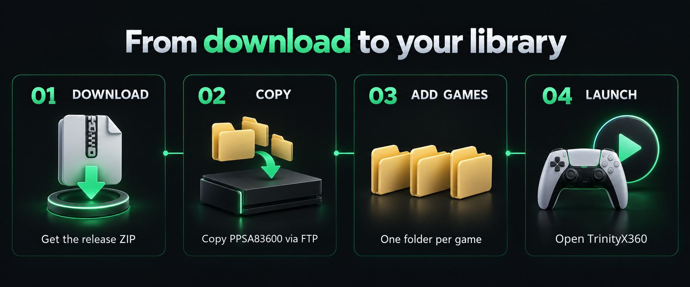

<p align="center">
  
</p>

<p align="center">
  <a href="https://github.com/grzegorz2047/TrinityX360/releases"><strong>Download</strong></a> ·
  <a href="https://github.com/grzegorz2047/TrinityX360/releases">Release notes</a> ·
  <a href="docs/INSTALLATION.md">Installation guide</a> ·
  <a href="docs/GAME-CONTENT.md">DLC, updates and discs</a> ·
  <a href="https://github.com/grzegorz2047/TrinityX360/issues">Report an issue</a>
  <a href='https://ko-fi.com/A0A21SWG1P' target='_blank'></a>
  
</p>

# TrinityX360

An **Xbox 360 emulator for PlayStation 5**, based on [PS5X360](https://github.com/BrinooTk/PS5X360)
by BrinooTk and on [Xenia Canary](https://github.com/xenia-canary/xenia-canary), with native
DualSense input, audio output and RADV Vulkan graphics.

**New name from v1.0.6.** Until v1.0.5 this app was called **PS5X360Reloaded**. Only the name
changed (see [New name: TrinityX360](#new-name-trinityx360)): the title id is still `PPSA83600`,
so it installs over PS5X360Reloaded as an update and keeps your saves and settings.

This repository is a fork of [BrinooTk/PS5X360](https://github.com/BrinooTk/PS5X360). Since
**v1.0.3**, its releases are **built from source**: the PS5X360 v1.0.2 sources the original
author published, reassembled, with this fork's fixes on top. The `eboot.bin` is compiled, not
patched; it is **Vulkan only** and released under **GPL-3.0** with its complete source attached
to the release.

Since v1.0.3 the fork is a separate app (PS5X360Reloaded until v1.0.5, **TrinityX360** since
v1.0.6), with its own title id **`PPSA83600`**, its own home screen tile and its own data folder
`/data/homebrew/PPSA83600`. It
installs **next to** the official PS5X360 (`PPSA50011`) and never writes to the official app's
folder. On its first start it copies your PS5X360 saves once (see
[Next to the official PS5X360](#next-to-the-official-ps5x360)).

The earlier releases of this fork, `v1.0.2-opt` and `v1.0.2-opt-r2`, were the official v1.0.2
executable with binary patches. They are superseded: every patch they carried (and the ones made
after r2) is now a source change in v1.0.3. See [tools/binary-release](https://github.com/grzegorz2047/TrinityX360/blob/v1.0.6/tools/binary-release/README.md).

**Games run, but compatibility varies.** Expect crashes, visual errors and uneven performance in
some titles. There is no promise of full-library compatibility or 60 FPS.

## New name: TrinityX360

From v1.0.6 the app is **TrinityX360** (Trinity is the name of the Xbox 360 S motherboard). The
homebrew catalog does not list an app whose name contains the name of an app it already lists,
so the fork, PS5X360Reloaded until v1.0.5, needed a name of its own. What changed and what did not:

- The home screen tile, its icon and backgrounds, the home screen label (**TrinityX360 v1.0.6**),
  the guide, notifications, the web settings and phone camera pages say TrinityX360, and the
  emulator's home screen shows TrinityX360's pictures in place of the PS5X360 logo.
- The title id is still **`PPSA83600`** and the data folder `/data/homebrew/PPSA83600`. Install
  v1.0.6 over PS5X360Reloaded as you would any update: the console keeps one tile, and your saves,
  settings, game folders and caches stay. On its first start v1.0.6 moves the settings from
  `/download0` to `/data/homebrew/PPSA83600`.
- The saves folder on each external drive keeps its name, `<drive>/PS5X360Reloaded/saves`. Do not
  rename it.
- The PS5 keeps the old icon and name (PS5X360Reloaded) after an update: it stores them when the
  app is first installed. To see TrinityX360's, start the PS5 in **Safe Mode** and choose
  **Rebuild Database** (it keeps games, apps and saved data). Deleting the app (**Options** >
  **Delete** on its tile) and installing it again also works, but it erases the app's `/download0`,
  with the saves kept in **Internal storage** (a choice of the **Save drive** setting). Copy
  `/mnt/sandbox/PPSA83600_000/download0/xbox360ps5` to your computer over FTP first (while
  TrinityX360 is open) and copy it back afterwards; saves on an M.2 or USB drive stay. Start
  v1.0.6 once before deleting the app, so that it moves your settings out of `/download0`.
- Forwarder tiles that start `PPSA83600` keep working.
- The repository is now `github.com/grzegorz2047/TrinityX360`; the old address,
  `github.com/grzegorz2047/PS5X360Reloaded`, redirects there.

## v1.0.6

The latest release. The home screen shows **TrinityX360 v1.0.6**. The full notes, with what was
confirmed on the console and what only by host tests, are in
[docs/release-notes/v1.0.6.md](https://github.com/grzegorz2047/TrinityX360/blob/v1.0.6/docs/release-notes/v1.0.6.md);
the notes of earlier versions are on the [releases page](https://github.com/grzegorz2047/TrinityX360/releases).

- **New name:** TrinityX360 with new art and new home screen icons. Same app, same title id
  `PPSA83600`; it installs over PS5X360Reloaded (see [New name: TrinityX360](#new-name-trinityx360)).
- **"Automatic" resolution scale, the new default:** games run at 2x while they keep 30 FPS and
  have enough memory, otherwise at 1x. Kinect games, GTA V, Battlefield 3, Tekken Tag Tournament 2
  and Red Dead Redemption start at 1x.
- **Games:** GTA IV drives without the growing pauses and has optional draw distance patches;
  GTA V installs from its Install disc, gets past the prologue freeze and holds 30 FPS; Dance
  Central 3 starts and plays; Virtua Tennis 3 no longer freezes in replays; FIFA Street's pitch is
  no longer black.
- **Kinect:** Kinect Sports: Season Two's darts loads, Fighters Uncaged gets past player
  identification, Kinect Sports records replays without stutter, and Kinect games at 2x no longer
  drop to 0–2 FPS after a few minutes.
- **Picture:** anti-aliasing (FXAA, SMAA), color presets, overscan crop, a 900p emulated
  resolution and a screen frame rate limit; no more short screen freezes every ~30 seconds.
- **Settings:** a new settings menu with clearer names and help in the guide; settings, per-game
  settings, game folders and covers are now kept in `/data/homebrew/PPSA83600`, so they survive a
  reinstall.

## Installation



The [latest release](https://github.com/grzegorz2047/TrinityX360/releases/latest) has:
- `PPSA83600.ffpkg`: a UFS2 image, mounted by etaHEN / ShadowMountPlus.
- `PPSA83600.ffpfsc`: a compressed PFS image, mounted by ShadowMountPlus.
- `PPSA83600.zip`: the `PPSA83600` folder to copy over FTP (checksum in `PPSA83600.zip.sha256`).
- The game patch files (`*.patch.toml`, also inside the packages), the GPL-3.0 source archives
  (see [Licenses](#credits-and-licenses)) and `SHA256SUMS.txt` over all files.

Install **one** of them: the image or the ZIP folder, not both (two copies of `PPSA83600` are a
duplicate for ShadowMountPlus).

**Image (`.ffpkg` / `.ffpfsc`):** copy `PPSA83600.ffpkg` (or `PPSA83600.ffpfsc`) to the place
ShadowMountPlus mounts images from (on the development setup, the USB drive), keeping the file
name: ShadowMountPlus
names the mount after it (`/mnt/shadowmnt/PPSA83600_*`). Then open **TrinityX360** from the
PS5 home screen. To update, close the emulator, replace the image with the new one and start it
again; if a game hung on exit, restart the console first, because the old image can stay mounted
until then. With an image install, `/data/homebrew/PPSA83600` holds only the emulator's data
(saves, cache, logs and, from v1.0.6, your settings): do not put `eboot.bin` or `sce_sys` there.
Settings are not part of the image. An image is read-only, so put the games on
another drive and add the folder in **Settings → Game folders**.

**ZIP:**
1. Extract `PPSA83600.zip` on your computer.
2. Using FTP, copy the **whole** `PPSA83600` folder to `/data/homebrew/`, overwriting existing
   files. When you update, keep the `saves`, `cache` and `logs` subfolders of the previous
   install. The executable must end up at `/data/homebrew/PPSA83600/eboot.bin`.
3. Let ShadowMountPlus register the title, then open **TrinityX360** from the PS5 home screen.
4. Put each game in its own folder under `PPSA83600/assets/roms/`, or in a folder added in
   **Settings → Game folders**. Reopen the emulator or select **Settings → Refresh game list**.

> **Do not copy only `eboot.bin`** into an existing 1.0.2 or r2 install. The executable (since v1.0.3)
> reads language files keyed in English (`assets/lang/*.txt`, 16 files including `pt-BR.txt`);
> with the official files the whole interface is in English whatever language is selected, and
> the r2 `eboot.bin` does not match the newer language files either. Always install the whole
> package.

The development setup uses **PS5 firmware 13.60 with homebrew access, etaHEN, ShadowMountPlus
and kstuff**. Other setups have not been verified. You need an already working homebrew
environment. The Helper (autoload ELF) of the official releases updates the official PS5X360
from the official releases page; whether it does anything with `PPSA83600` is not checked.

The [full installation and usage guide](docs/INSTALLATION.md) has the details (logs, saved data,
troubleshooting); it uses TrinityX360's folder, `PPSA83600`.

### Next to the official PS5X360

TrinityX360 (`PPSA83600`) and the official PS5X360 (`PPSA50011`) are two apps with two
tiles, and both can stay installed. Each has its own data folder (`/data/homebrew/<title id>`)
and its own `/download0`. Only one runs at a time.

**Remove the old images of this fork.** Earlier builds of this fork (`v1.0.2-opt`, r2 and the
`1.0.3_candidate_N` test images made before the rename) used the official title id. Delete any
`PPSA50011.ffpkg` / `PPSA50011.ffpfsc` of this fork from the USB drive: ShadowMountPlus treats
it as a duplicate of the official PS5X360. Your data in `/data/homebrew/PPSA50011` is not in the
image and stays where it is.

**Automatic import on the first start.** When TrinityX360 starts for the first time, it copies
once from `/data/homebrew/PPSA50011` (the folder the official app, `v1.0.2-opt`, r2 and the
earlier test builds used) into `/data/homebrew/PPSA83600`:
- `saves` (profiles, achievements, game saves, and the DLC and title updates installed there);
- small settings files and folders it does not have yet: `network.conf`, `vibration.conf`,
  `framegen.conf`, `ui-dark.on`, `ui-classic.on`, `dashboard.off`, `skin/`, `game-art/`,
  `dashboard/` and the achievements cache.

It only **reads** the official folder: nothing there is changed, moved or deleted. It copies the
saves only when the drive has enough free space for them; otherwise it copies no saves. It never
copies over saves TrinityX360 already has. The shader cache and the logs are not copied (the
cache is built again). A file it cannot read is skipped and named in the log.

To copy the saves by hand instead (for example after the import was skipped for lack of space;
make room on the internal storage first, because the copy needs as much space as the saves take):
with both apps closed, copy `/data/homebrew/PPSA50011/saves` over FTP to
`/data/homebrew/PPSA83600/saves`. Do it before you play in TrinityX360, because it replaces
saves made there.

**Settings in `/download0` do not carry over.** `/download0` belongs to each title id, so
TrinityX360 starts with an empty one. This covers `settings.txt`, `profile.txt`, the game
folders (`game_paths.txt`), recent games (`recent.txt`), per-game settings (`game-settings/`),
the FSI choices (`fsi.c`, `fsi.1`), `framegen.conf`, `covers/`, `patches/` and `game-configs/`.
To move them by hand over FTP:
1. Close TrinityX360. Open the official PS5X360: its `/download0` is reachable only while
   it runs.
2. Download `/mnt/sandbox/PPSA50011_000/download0/xbox360ps5` to your computer. The `_000`
   suffix can differ; use the `PPSA50011_*` folder that has `download0`.
3. Close the official PS5X360 completely. Open TrinityX360 and stay on the home screen
   without changing any setting.
4. Upload the files and folders listed above into
   `/mnt/sandbox/PPSA83600_000/download0/xbox360ps5/`, replacing the ones there. Leave out
   `LOGS/`, `boot.log` and `library/` (logs and the game list cache, which is rebuilt).
5. Close TrinityX360 completely and open it again: the settings are read when it starts.
   Then check **Settings → Game folders**: if the copied `game_paths.txt` lists
   `/data/homebrew/PPSA50011/assets/roms`, remove it (see **Games** below).

**Games.** The official app's `PPSA50011/assets/roms` is not one of TrinityX360's game
folders. Put games in `/data/xbox360` or in `xbox360` on a USB or M.2 drive: both apps list
those. Adding `/data/homebrew/PPSA50011/assets/roms` in **Settings → Game folders** is not
advised: TrinityX360 installs and moves the DLC and update packages it finds in a game
folder's inboxes, so it would change files in the official app's folder.

**Saves on other drives** (fix 27) are in `<drive>/PS5X360Reloaded/saves` since v1.0.4 (fix 50;
a drive's older `<drive>/PS5X360/saves` is moved there once). The rename to TrinityX360 kept this
folder's name, so nothing needs moving there.

**Forwarders.** Forwarder Manager tiles made for the `PS5X360` target start the official app
(`PPSA50011`). For TrinityX360, a tile needs the target `PPSA83600`: choose the **Generic**
target and enter `PPSA83600`, or change `"target"` in the tile's `forwarder.json`. Steps in
[docs/FORWARDER.md](https://github.com/grzegorz2047/TrinityX360/blob/v1.0.6/docs/FORWARDER.md).

**Kinect tracker.** The official `kinect-tracker.elf` sends its frames with the web-settings key
from `/data/homebrew/PPSA50011`. TrinityX360 also accepts that key (read only) for tracker
frames sent from the console itself (127.0.0.1); requests from the network still need its own
key. This works only if that key file exists, i.e. the official app or an earlier build of this
fork has run once.

## Game status on the console

Results on a PS5. The rows marked *v1.0.6* were checked on the v1.0.6 test builds; most others
come from `1.0.3_candidate_N` test builds (source builds labelled that way on the home screen).
Rows marked *binary build* were measured on the official v1.0.2 executable with this fork's
binary patches and not again on a source build. FPS values come from the
emulator's own logs.

| Game | Status | Notes |
| --- | --- | --- |
| Battlefield 3 (`45410950`) | works, about 25–30 FPS | Fix 30 with the built-in `memexport=1` preset, and fix 20. Menu and levels without hanging in `candidate_36` and `candidate_37` (with `memexport` set by hand). The preset on its own is host-tested, not yet tried on the console without the manual setting. The official 1.0.2 hangs. |
| Minecraft: Xbox 360 Edition (`584111F7`) | 59–60 FPS in the world in **Online** or **Offline** mode | Fix 31 (`candidate_33`; 1.3 FPS without it). In **System Link** mode the game can crash while loading or leaving a world; fix 45 shows the crash and the guide returns to the library. |
| Handball 16 (`573607E4`) | starts, gets past START, about 50–57 FPS | Fix 26 (`candidate_26`, with extra diagnostics). |
| Naruto: The Broken Bond (`55530825`) | starts, reaches the save-location prompt | Fix 28 (`candidate_23`, before some later fixes; not retested with the full build). |
| Call of Duty: Black Ops | runs; 18.6–18.8 FPS (*binary build*) | Switches from its menu to the campaign (fix 33). Character hair is drawn in wrong colours in every build, including r2 ([#10](https://github.com/grzegorz2047/TrinityX360/issues/10)). |
| Call of Duty: Modern Warfare 2 | runs; about 20 FPS (*binary build*) | No regressions in the source candidates. |
| Army of Two | works | Regression run of `candidate_47`; started from a forwarder tile in `candidate_34`. |
| Battlefield: Bad Company (`454107F9`) | 60 FPS after the first shader compile (*binary build*) | With the game's 60 FPS patch, the preset (FSI off, `readback=0`, `pipeline_threads=3`) and the VSync cap (fix 10). |
| Fable II (`4D5307F1`) | 30 FPS, the game's own cap, with tuned settings (*binary build*) | Measured with `memory_boost` and `fast_dot` on and `fast_locks`, `readback` and `clear_pages` off in the game's settings (26.4 FPS before). v1.0.3 uses the official preset again (`clear_pages=1`, `readback=1`); `fast_locks` on makes the game ignore the controller. |
| Fable III (`4D5308D6`) | about 22–24 FPS (*binary build*) | r2 preset, config and optional patches, unchanged in v1.0.3. |
| Ninja Gaiden II (`544307D5`) | closes about 30 s after the intro videos | [#11](https://github.com/grzegorz2047/TrinityX360/issues/11) |
| Dragon Ball Z for Kinect (`4E4D084E`) | works with the emulated Kinect camera (*v1.0.6*) | Steady 30 FPS with a test relay (`candidate_49`); still works with the updated player identification. |
| Grand Theft Auto IV (`545407F2`) | 43–58 FPS at 2x under "Automatic" (*v1.0.6*) | The pauses that grew while driving are gone in test runs at 1x. Optional "Draw Distance +25%" and "+50%" patches. |
| Grand Theft Auto V (`545408A7`) | steady 30 FPS, the game's own cap, at 1x (*v1.0.6*) | Installs from "Disc 1 (Install)"; the built-in "Audio freeze fix (prologue)" patch gets it past the prologue. |
| Dance Central 3 (`373307D9`) | plays, 45–59 FPS (*v1.0.6*) | On the first start it asks for the game's music keys (QR code); a full song after a restart. |
| Kinect Sports (`4D5308C9`) | plays at 1x, 45–59 FPS (*v1.0.6*) | Replays recorded without stutter. |
| Kinect Sports: Season Two | darts loads and plays (*v1.0.6*) | Some stutter remains ([#63](https://github.com/grzegorz2047/TrinityX360/issues/63)); the other sports are not confirmed yet. |
| Fighters Uncaged (`5553084E`) | reaches Training, about 60 FPS (*v1.0.6*) | Gets past player identification with the signed-in profile. |
| Zumba Fitness Core | finds the camera, stops at "Searching for player" (*v1.0.6*) | [#68](https://github.com/grzegorz2047/TrinityX360/issues/68) |
| Virtua Tennis 3 | no freeze during replays (*v1.0.6*) | About 25 minutes over two sessions. |

## Known limitations

- **No OpenGL renderer** ([#6](https://github.com/grzegorz2047/TrinityX360/issues/6)): its
  sources were never published. Choosing OpenGL in a game's settings falls back to Vulkan.
- **No games from the PS5 disc drive** ([#7](https://github.com/grzegorz2047/TrinityX360/issues/7)):
  a disc in the drive is not listed, and the `disc-helper.elf` relay does not work.
- **Physical USB Kinect** ([#8](https://github.com/grzegorz2047/TrinityX360/issues/8)): the
  USB camera and relay client are back (fix 44) and the relay client works on the console with a
  test relay, but nobody has tried it with a real Kinect for Xbox 360 (model 1414/1473) yet.
- **Smaller gaps to the official 1.0.2** ([#9](https://github.com/grzegorz2047/TrinityX360/issues/9)):
  fixes 40–43 in v1.0.3 close most of them. Still different: a private Fable II input diagnostic
  is left out on purpose, the dark theme is reconstructed, and the debug-output wrapper belongs to
  the missing OpenGL renderer (#6).
- **Compiler flags** ([#2](https://github.com/grzegorz2047/TrinityX360/issues/2)): the title
  stays at `-O2`; `-O3` titles and ThinLTO gave no measurable gain.
- **Newer upstream JIT work** ([#5](https://github.com/grzegorz2047/TrinityX360/issues/5)):
  the changes that apply to this core are in (fixes 01 and 38); later upstream series and newer
  PS5_Vulkan / PS5_Mesa are not.
- Not byte-identical to the official 1.0.2: the `eboot.bin` is a reconstruction, about 22 MiB
  smaller, almost all of it the missing OpenGL stack.

## Start a game from the PS5 home screen (forwarders)

A forwarder is a small app with its own home screen tile that starts TrinityX360 straight
into one game (fix 21): `--rom <game>` with a full path, a path in the game folders, a folder or a
title ID, and `--exit-after-game` to return to the PS5 home screen when the game closes. Tiles are
made with Forwarder Manager, with the target title id `PPSA83600` (its `PS5X360` target starts
the official app). Close TrinityX360 before using a tile: arguments only reach a new
TrinityX360 process. When the forwarder launcher is already running, ShadowMountPlus may
refuse the start (`0x80940033`, [drakmor/ShadowMountPlus#196](https://github.com/drakmor/ShadowMountPlus/issues/196)).
Setup and workarounds: [docs/FORWARDER.md](https://github.com/grzegorz2047/TrinityX360/blob/v1.0.6/docs/FORWARDER.md).

## Organize your games

```text
PPSA83600/
├── eboot.bin
├── sce_module/
├── sce_sys/
└── assets/
    └── roms/
        ├── Game One/
        │   ├── default.xex
        │   └── ...game data...
        ├── Game Two/
        │   └── game.iso
        └── Game Three/
            ├── ...GOD or STFS package...
            └── ...matching .data folder, if required...
```

Keep all extracted game data together. Use **Settings → Game folders** to add more locations,
including external drives. See the
[folder configuration guide](docs/INSTALLATION.md#multiple-locations-and-external-devices-development-v030-preview).

**No games, console BIOS or keys are included.**

## Controls

| DualSense button | Home | Library |
| --- | --- | --- |
| D-pad / stick up and down | Change channel | — |
| D-pad / stick left and right | Choose a slot | Choose a game |
| Cross | Open | Open the game's sheet (Play, Patches, Settings, Achievements, DLCs, Updates) |
| Triangle | — | The game's settings |
| Square | Settings | Settings |
| L1 / R1 | — | Change library filter |
| Circle | — | Back to the home |
| Touchpad, during a game | Open the emulator guide | |

The guide offers resume, the library over the running game, settings, Xbox BACK and exit. To use
the touchpad as Xbox BACK instead, change **Settings → Touchpad click**; the guide then opens with
**OPTIONS + touchpad**.

## What TrinityX360 includes

- A home screen and cover library for extracted games (XEX), ISO images and GOD/STFS packages,
  with folders and filters.
- **DLC and title updates**, installed from the game's sheet or automatically when you press Play;
  **games with several discs**. See [DLC, updates and discs](docs/GAME-CONTENT.md).
- Per-game settings and community Xenia Canary patches, matched to the game's executable version.
- Player profiles for up to four local players, saved games and achievements with notifications.
- An in-game guide, opened with the touchpad: resume, the library over the running game, settings.
- Frame generation (FSR3, experimental), FPS display, CAS sharpening and FSR upscaling.
- Kinect through a phone camera (experimental; see the Kinect limits above), settings from a
  phone or computer.
- Online play through Xenia netplay, and System Link (experimental). Use the game's Xbox LIVE
  menu; System Link only finds games on your home network.
- Covers from XboxUnity and Microsoft's image server.
- An interface in **16 languages**, following the PS5 language, and a dark theme.
- Per-game log files, downloadable as a ZIP. The PS5X360 Content Installer for Windows
  ([tools/content-installer](tools/content-installer/README.md)) installs DLC and title updates
  over the network.

## Compatibility and bug reports

Booting into a menu is not the same as completing gameplay. The
[compatibility notes](docs/COMPATIBILITY.md) separate what was seen on a console from host tests.

When you report a bug, include the game, title ID, region and version; the enabled patches; the
firmware and the emulator version (the home screen shows it); the exact point where the game
fails; a short video or screenshot if you can; and the matching game-session logs. Logs are in
`/data/homebrew/PPSA83600/logs`, or in `download0/xbox360ps5/LOGS` if that folder cannot be
written. The included log downloader can create a ZIP to share.

- **TrinityX360 (`PPSA83600`; PS5X360Reloaded from v1.0.3 to v1.0.5) and its test builds:** report on
  [this repository](https://github.com/grzegorz2047/TrinityX360/issues).
- **The official PS5X360 (`PPSA50011`):** report on [BrinooTk/PS5X360](https://github.com/BrinooTk/PS5X360/issues).

## Branches

| Branch | Contents |
| --- | --- |
| [`source-1.0.2-patches`](https://github.com/grzegorz2047/TrinityX360/tree/source-1.0.2-patches) | Development: the assembly and build scripts of the source rebuild, the reconstructed files and every fix (`tools/source-1.0.2/fixes`). Fixes are made on `fix/*` branches and merged here. |
| [`release/source-1.0.6`](https://github.com/grzegorz2047/TrinityX360/tree/release/source-1.0.6) | The release commit of v1.0.6 (each version has its own `release/source-X.Y.Z`). A push builds the draft release (`release-source.yml`). |
| [`main`](https://github.com/grzegorz2047/TrinityX360/tree/main) | The default branch: its landing page, the repository's older C++ (v0.5.7-fix.1, not used by the releases) and a copy of `build-source-1.0.2.yml` for the *Run workflow* button. The tools of the superseded binary releases (`tools/binary-release`) are on the source branches above. |

## Building from source

The v1.0.2 sources are not one tree: [`tools/source-1.0.2/assemble.py`](https://github.com/grzegorz2047/TrinityX360/blob/v1.0.6/tools/source-1.0.2/assemble.py)
downloads the author's source packages (`0.5.9-fix1`, `0.6.0`, `1.0.0`, `1.0.2`, pinned by
SHA-256) and the Xenia Canary netplay core (`AdrianCassar/xenia-canary` `d2cf527aa`), layers them,
adds the reconstructed headers and applies the fixes. What came from where, and what is missing,
is in [docs/SOURCE-1.0.2.md](https://github.com/grzegorz2047/TrinityX360/blob/v1.0.6/docs/SOURCE-1.0.2.md); the fixes are listed in
[tools/source-1.0.2/fixes](https://github.com/grzegorz2047/TrinityX360/blob/v1.0.6/tools/source-1.0.2/fixes/README.md).

**Host checks** (no PS5 toolchain; needs Python 3 and clang 18):

```sh
python3 -I tools/source-1.0.2/assemble.py --out build/src102
bash tools/source-1.0.2/run-fix-checks.sh build/src102
```

**The `eboot.bin`:** set up the toolchain as the steps of
[`build-source-1.0.2.yml`](.github/workflows/build-source-1.0.2.yml) do (Ubuntu 24.04,
clang/lld 18, Vulkan SDK 1.4.341.1 shader tools, the `mihawk-99` repositories `PS5_Vulkan`,
`PS5_Mesa` and `PS5_PayloadSDK` at the pinned commits in `.deps/references`, RADV built by
`tools/build-radv-platform.sh`), then:

```sh
bash tools/source-1.0.2/build.sh build/src102 build/src102-out   # -> build/src102-out/eboot.bin
```

**In GitHub Actions:**
- `source-fix-checks.yml` runs the host checks on pushes to `source-1.0.2-patches` and the
  `fix/*` branches that change the fixes or their checks.
- `build-source-1.0.2.yml` (by hand: `gh workflow run build-source-1.0.2.yml --repo
  grzegorz2047/TrinityX360 --ref source-1.0.2-patches`) runs the host checks, then builds a
  test `eboot.bin`. Its artifact `eboot-1.0.2-from-source-NOT-FOR-RELEASE` is for console tests
  only; test builds are labelled **TrinityX360 vX.Y.Z_candidate_N** on the home screen
  (`tools/source-1.0.2/BUILD_VERSION`).
- `release-source.yml` runs on a push to `release/source-X.Y.Z`: a release build (version label
  `X.Y.Z`, no fix left out), the package (`tools/source-1.0.2/package.py`), the images and a
  **draft** release `vX.Y.Z` with the source archives. Publishing the draft is a manual step.

## Credits and licenses

Based on [PS5X360](https://github.com/BrinooTk/PS5X360) by BrinooTk and on
[Xenia Canary](https://github.com/xenia-canary/xenia-canary). Other components: the
[PS5_Vulkan](https://github.com/mihawk-99/PS5_Vulkan) RADV work and the native runtime and tooling
listed in [Credits](docs/CREDITS.md); online play from
[Xenia Canary netplay](https://github.com/AdrianCassar/xenia-canary) by AdrianCassar, with
libcurl, wolfSSL and miniupnpc; frame generation from
[ps5-framegen](https://github.com/Swordpdf/ps5-framegen) by Swordpdf; community patches from
[xenia-canary/game-patches](https://github.com/xenia-canary/game-patches); covers from XboxUnity
and Microsoft's image server.

Licenses:
- **The released `eboot.bin` is GPL-3.0** as a whole: it links wolfSSL and ps5-framegen (both
  GPL-3.0-or-later). Each part keeps its own licence too: the MIT-licensed PS5X360 code stays
  MIT, Xenia is BSD-3-Clause. The package's `PPSA83600/licenses/` folder has every licence text
  and the notice `PS5X360-1.0.3-NOTICE.txt`. From 1.0.4, the package's `LICENSE` is the GPL-3.0
  text and `PPSA83600/licenses/` has `PS5X360-MIT.txt` (the MIT notice of the PS5X360 code);
  v1.0.3 shipped the official MIT `LICENSE`.
- **The source is attached to each release:** `PS5X360-1.0.3-source.tar.xz` (the tree the
  `eboot.bin` was compiled from, with `SOURCES.json`), `PS5X360Reloaded-1.0.3-scripts.tar.gz`
  (this repository at the release commit; `TrinityX360-<version>-scripts.tar.gz` from v1.0.6), `PS5X360-1.0.3-toolchain-source.tar.xz` (the toolchain
  and the statically linked RADV/Mesa and PS5 runtime at the pinned commits) and the build log.
  Anyone who distributes a rebuilt `eboot.bin` must do so under the GPL-3.0, with its complete
  source.
- **This repository is GPL-3.0** as a whole ([LICENSE](LICENSE)), like the `eboot.bin` built from
  it. The PS5X360 code by BrinooTk and the earlier contributions came under the MIT License and
  keep its notice ([licenses/PS5X360-MIT.txt](licenses/PS5X360-MIT.txt)), which must stay with
  that code; MIT code may be part of a GPL-3.0 work, and this does not relicense it. Bundled
  third-party components keep their licenses ([licenses/](licenses/), the font's
  [SIL Open Font License](assets/fonts/OFL.txt)).

TrinityX360 (formerly PS5X360Reloaded), like PS5X360, is an independent community project and is not affiliated with
Sony or Microsoft. The README artwork is illustrative branding, not an emulator screenshot.

## Support the projects

To support the original author, BrinooTk, you can contribute through
[Ko-fi](https://ko-fi.com/brinoblitz). Testing, bug reports and sharing the project also help.

Older M0–M8 milestones and Portuguese research notes are preserved in
[the port history](docs/PORT_HISTORY_PT.md); the upstream changelog is in [CHANGELOG.md](CHANGELOG.md).

## Automatic diagnostic reports

The optional **AutoLog ELF preview** of the official releases reads game logs on the PS5 and
sends them to the developer of the official build, without a PC. It is loaded separately once per
console boot. Before enabling it, read the [reporting notice and instructions](native/autolog/README.md)
(opt-out and limits); for the optional PC fallback see [AutoLog setup](docs/AUTOLOG.md). It reads
the official app's logs in `/data/homebrew/PPSA50011/logs`, so it does not see TrinityX360's
logs (`/data/homebrew/PPSA83600/logs`).
